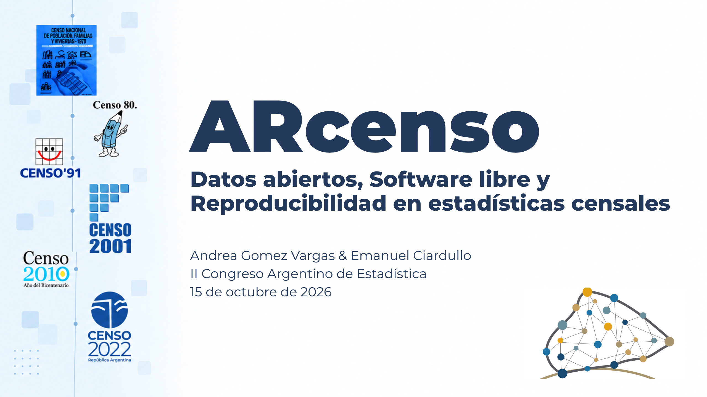
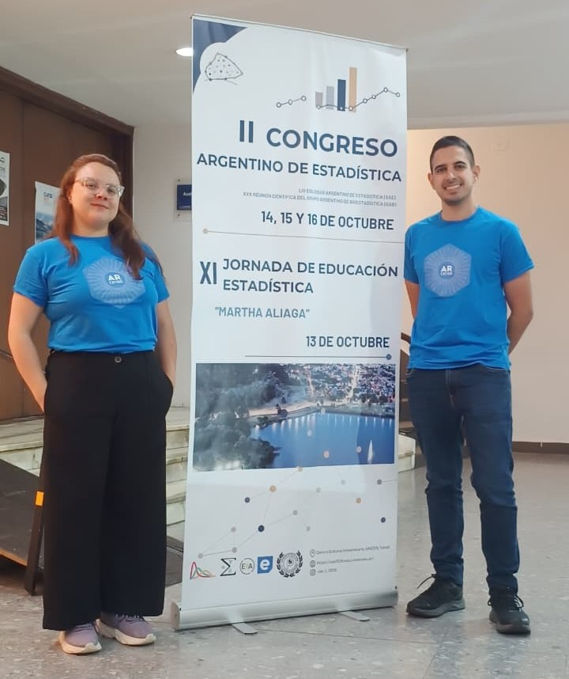

# ARcenso: Datos abiertos, Software libre y Reproducibilidad en estadísticas censales

{fig-align="center"}
<br>

## Resumen

El 15 de octubre de 2026 presentamos ARcenso, junto con Emanuel Ciardullo, en el II Congreso Argentino de Estadística (CAE 2026) en Tandil, en la modalidad de comunicaciones orales, dentro del área de Estadísticas oficiales.


:::::: columns
::: {.column width="55%"}

Durante la presentación compartimos cómo surgió ARcenso y cómo desarrollamos su primera versión, abordando los fundamentos teóricos y metodológicos que orientaron el proyecto, así como el proceso de organización y procesamiento de los datos censales mediante R. También mostramos las funcionalidades actuales del paquete y los próximos pasos para continuar ampliando su cobertura y desarrollo.


Compartimos la sesión con otras exposiciones sobre el acceso a información estadística, la armonización de datos para la construcción de indicadores comparables en América Latina y la apertura, interpretación y uso de las estadísticas oficiales en la provincia de Buenos Aires. Estas experiencias permitieron ampliar la discusión sobre la importancia de producir, difundir y reutilizar datos públicos.


:::

::: {.column width="5%"}
:::

::: {.column width="40%"}
<div style="display: flex; justify-content: left; margin: 2rem 0;">
  <iframe
    style="width: 280px; height: 400px; border: 0;"
    src="https://www.youtube.com/embed/UTfzKTnQsO8"
    title="ARcenso en el CAE 2026"
    allowfullscreen>
  </iframe>
</div>

:::
::::::


:::::: columns
::: {.column width="40%"}

{width="280px" height="280px" fig-align="left"}


:::

::: {.column width="60%"}

Además de compartir nuestro trabajo, el congreso fue una linda oportunidad para encontrarnos con colegas, conocer otras experiencias y conversar sobre los desafíos de las estadísticas oficiales. Nos llevamos nuevos intercambios e ideas para seguir trabajando en ARcenso y fortaleciendo los vínculos con la comunidad estadística del país.

_Expositores: [Andrea Gomez Vargas](https://github.com/SoyAndrea)] & [Emanuel Ciardullo](https://github.com/ECiardullo)_


:::
::::::


### Slides

```{r echo=FALSE}
knitr::include_url("https://soyandrea.github.io/arcenso-cae2026/#/title-slide",height = 400)
```


### Links de interés

- web ARcenso <https://soyandrea.github.io/arcenso/>
- Repositorio ARcenso <https://github.com/SoyAndrea/arcenso>
- slides [soyandrea.github.io/arcenso-cae2026](https://soyandrea.github.io/arcenso-cae2026/#/title-slide)

