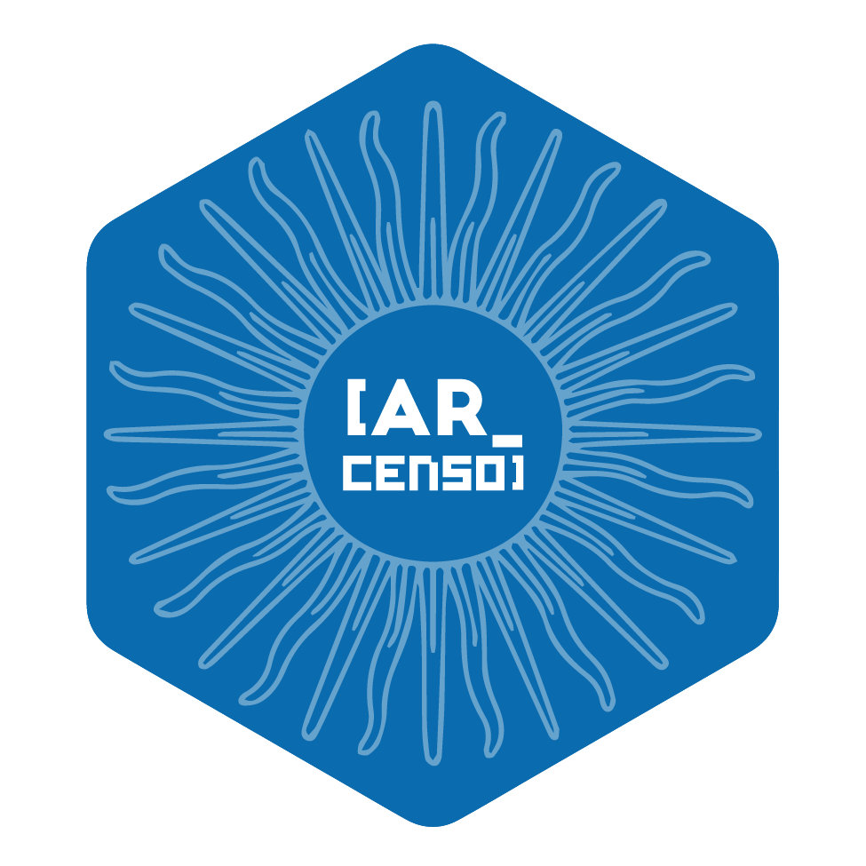

## Perfil Profesional

Socióloga con experiencia en producción y análisis de estadísticas oficiales, especializada en información social y de población. Orientada en procesamiento e integración de censos, encuestas y registros administrativos, construcción de indicadores y desarrollo de productos estadísticos para el análisis y la gestión pública.

::: hex-card
[Download CV (PDF)](documentos/GOMEZ%20VARGAS%20ANDREA%20CV.pdf)
:::

## Experiencia profesional

**Analista de Estadísticas Poblacionales, INDEC (2021 – actualidad)**

*Rol en la Dirección Nacional de Estadísticas Sociales y de Población. Buenos Aires.*  

Trabajo en el diseño y desarrollo de procesos integrados de análisis en R para el procesamiento de información proveniente de censos, encuestas y registros administrativos, utilizando R y SQL. Desarrollo indicadores sociodemográficos a nivel nacional, que se integran en publicaciones estadísticas e instrumentos digitales interactivos (como tableros), diseñados de forma complementaria para facilitar su acceso, análisis y difusión.

> Mi trabajo se centra en estadísticas sociales y de población, con foco en la reproducibilidad, los datos abiertos y la comunicación accesible.

::: concise
*Publicaciones:*

- [Shiny app - Sistema Integrado de Estadísticas Sociales (SIES)](https://shiny.indec.gob.ar/sies/)
- [Shiny app - Tablero personas mayores](https://shiny.indec.gob.ar/tablero_pm/)
- [Publicación Síntesis de resultados - Censo 2022](https://censo.gob.ar/index.php/censo-2022-sintesis-de-resultados/)
- [Dosier Estadístico Día Internacional de la Mujer](https://www.indec.gob.ar/ftp/cuadros/publicaciones/dosier_estadistico_8M_2023.pdf)
- [Dosier Estadístico de personas mayores](https://www.indec.gob.ar/ftp/cuadros/poblacion/dosier_personas_mayores_2023.pdf)
- [Dosier Estadístico de niñas, niños y adolescentes](https://www.indec.gob.ar/ftp/cuadros/poblacion/dosier_nnya_11_237A4EFD2B08.pdf)
- [Encuesta Nacional de Uso del Tiempo 2021. Resultados](https://www.indec.gob.ar/ftp/cuadros/sociedad/enut_2021.pdf)
:::

### Consultorías

- **Fundación Huésped: Prevención - Ciencia - Derechos**

Analisis de datos y elaboración de reporte de Resultados Encuesta de Salud para Personas Migrantes 2024

Buenos Aires

01/08/2024 - 30/09/2024

- **Dirección General de Inserción Laboral de la Mujer, Gobierno de la Ciudad de Buenos Aires**

Elaboración de capacitación Mujeres & IT para el Programa de habilidades para la empleabilidad.

Buenos Aires

01/03/2023 – 31/10/2023

### Experiencia docente

- **Instituto Nacional de Estadística y Censos - INDEC**, Instructora. Ciclo de formación en R: desarrollo de tableros interactivos con R y Shiny (JU44891/26). Buenos Aires, 2026.

- **Consejo Nacional de Investigaciones Científicas y Técnicas - CONICET**, Docente. Curso Aplicaciones interactivas con R y Shiny para investigación. Buenos Aires - Virtual. 2025.

- **Universidad Nacional Guillermo Brown - UNAB**, Docente adjunta dedicación simple. Materia Visualización de la Información - carrera de grado ciencia de datos. Buenos Aires - Virtual. 2023-2024.

- **Universidad Nacional de San Martín - UNSAM**, Profesora de Posgrado. Diplomatura en Ciencias Sociales Computacionales y Humanidades Digitales. Buenos Aires - Virtual. 2023.

- **Asociación Argentina de Especialistas en Estudios del Trabajo - ASET**, Docente. Curso de Introducción al Procesamiento de Datos con R edición 2022 & 2023. Virtual. 2022-2023.

- **Facultad Latinoamericana de Ciencias Sociales - FLACSO**, Tutora técnico-pedagógica. Curso de Posgrado Big Data e Inteligencia Territorial. Virtual. 2022-2021.

## Desarrollo de Software 📦

::::: columns
::: {.column width="30%"}
{width="80%"}
:::

::: {.column width="70%"}
**ARcenso**: paquete en R con datos censales de población Argentina.

Desarrolladora principal [github.com/SoyAndrea/arcenso](https://github.com/SoyAndrea/arcenso/)

Buenos Aires - 2024

> [soyandrea.github.io/conoce-arcenso](https://soyandrea.github.io/conoce-arcenso.html)
:::
:::::

## Formación profesional

- **Maestría en Generación y Análisis de Información Estadística**

Universidad Nacional Tres de Febrero (UNTREF). Buenos Aires. 2024-actualidad.

- **Licenciatura en Sociología**

Universidad de Buenos Aires (UBA). Buenos Aires. 2021.

### Formación complementaria

- *Diplomado Fortalecimiento de las Capacidades Estadísticas*. Departamento Administrativo Nacional de Estadística (DANE), Colombia - 2026

- *Gobierno de Datos*. Sociedad Argentina de Informática (SADIO) -   2026

- *Curso de Minería de datos con Python.* UTN. Buenos Aires. 2025

- *Ciclo de formaciones en SQL: Bases de datos con SQL & selecciones avanzadas en SQL ORACLE* INDEC. Buenos Aires. 2023

- *Diseño y construcción de indicadores & Estadísticas Sociales 2.* DANE Colombia. Virtual. 2023

- *Aplicación del Sistema de Información Geográfica (SIG) en el análisis de indicadores sociodemográficos.* INDEC. Buenos Aires. 2022

- *Accesiblidad web: introducción y pautas & técnicas y herramientas para mejorarla.* INAP. Virtual. 2022

- *Social Data Analytics.* Escuela Argentina de Nuevas Tecnologías. Virtual. 2021

### Becas

- [R Project Sprint 2026](https://contributor.r-project.org/r-project-sprint-2026/participants/)

Financial support awarded by the R Consortium to participate in the R Project Sprint 2026, contributing to the development of R and collaborating with the international R community. Birmingham, UK, 2026

- [RSECon25 – Bursaries](https://rsecon25.society-rse.org/bursaries/)

Scholarship awarded to attend the Research Software Engineer Conference 2025 (RSECon25) in the UK, covering event registration, Coventry, 2025.

- [R Developer Day Scholarship - University of Warwick](https://rsecon25.society-rse.org/r-dev-day-rsecon25/)

Scholarship awarded for in-person participation in RDev Day, a satellite event of RSECon25 in the UK, contributing to R development and collaborating with the international community, Coventry, 2025.

- [posit::conf(2024) - Diversity Scholarship](https://posit.co/blog/posit-conf-2024-announcement/)

Scholarship awarded to individuals from underrepresented groups worldwide to attend posit::conf, Seattle, USA, 2024.

- [rOpenSci Champions Program cohort 2023 - 2024](https://ropensci.org/champions/)

Mentoring and training program supporting contributions to open science and research software. Buenos Aires, Argentina (virtual), 2023–2024.

## Congresos, charlas, ponencias

> **Ver más en [Charlas & Talleres](https://soyandrea.github.io/talleres.html) & [ARcenso](https://soyandrea.github.io/conoce-arcenso.html)**
